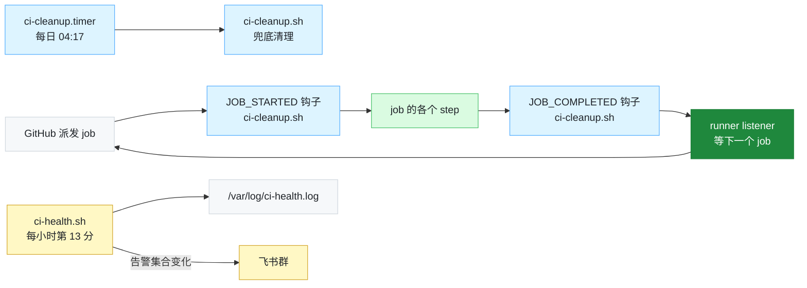

<p align="center">
  
</p>

<p align="center">
  
  
  
  
  
  
</p>

# 自建 GitHub Actions CI runner 部署手册

这份手册的用途：换服务器、换厂商或加服务器时不必重新调研一遍。用脚本验机、装机、自检，按 05 章改一遍 workflow，再对一遍验收表就能到位。

它是一套通用做法，覆盖选机、按机器规格定参数、装机、改 workflow、接线、验证和运维。脚本面向 x86_64 的 Ubuntu（测过 24.04）。做法不绑定厂商，云主机和裸金属都适用。换厂商时要核对的事（CPU 型号是否固定、登录方式、metadata 地址、防火墙在哪配、计费粒度等）见 [02 章 2.9](02-选机与验收.md)。

- 文中的实测数字来自参考项目：一个 pnpm monorepo 的 CI，跑在 Hetzner Cloud 一台 4 核、约 7.6 GiB 内存的共享 vCPU 云主机上。准备加第二台时又在同一家试过几台候选机（02 章 2.7）。没有特别说明时，数字指第一台。
- 引用实测值的地方都标了「参考项目」。这些数字是例子，不是要求。你的机器该跑几个实例、参数怎么取，按 10 章的公式算。

---

## 快速开始

按下面 7 步走。

```bash
# 1. 验机（只读）。端口填你项目 CI 占用的宿主端口（02 章开头）
CI_HOST_PORTS="<CI 会占用的宿主端口，空格分隔>" bash scripts/preflight.sh --with-load
REF=<现有 runner 的单核分数> bash scripts/machine-check.sh     # 第一台没有参考机，不给 REF

# 2. 装机和加固，先不注册，不需要 token。参数存到 /etc/ci-runner.env，下次重跑不用再传
#    新机器先跑这一步，再建开发用户等其他普通用户：它按 RUNNER_UID（默认 1000）建 runner 用户（03 章 3.3）
#    RUNNER_NAME 每台机器不同；标签所有机器相同
#    RUNNER_MEM_MAX、RUNNER_OOM_ADJ、BUILDKIT_* 不传就用默认值 6G、800、10GB/20GB/20GB，
#    这是参考项目 8 GB 内存、75 GB 盘、不在上面开发时的取值。别的规格按 10 章 10.3、10.4 算好后显式传
GH_REPO=owner/repo \
RUNNER_NAME=<每台不同，比如 ci-1> \
RUNNER_LABELS=self-hosted,linux,x64,myproj-ci \
CI_LABEL=com.myorg.ci=1 \
CI_APP_PORTS="<CI 在宿主上监听的端口，空格分隔，没有就留空>" \
CI_FIXEDWORK_BASELINE=<第 1 步 preflight 给的 p50> \
bash scripts/bootstrap.sh --skip-runner
#    然后以 runner 用户回放最慢的 job，核对超时余量（02 章 2.7）

# 3. 注册。PAT 用 read -s 输入，不留在 shell 历史里；注册完去 GitHub 撤销
read -rsp 'PAT: ' GH_TOKEN; echo; export GH_TOKEN
bash scripts/bootstrap.sh
unset GH_TOKEN
#    可选：CI_HEALTH_GH_TOKEN（只读 token，监控「本机 job 是否连续失败」用）、
#    CI_ALERT_WEBHOOK 和 CI_ALERT_SECRET（告警推送到飞书群）。同样用 read -s 输入后 export，再跑这一步

# 4. 自检。GitHub 侧那一组要只读 token，最好在 CI 机以外查（07 章）
bash scripts/verify.sh

# 5. 改 workflow：没有脚本，必须有人读一遍第 05 章
#    改完之前不要打开开关，否则第 2 个 PR 就会失败

# 6. 接线
gh variable set CI_RUNNER --repo owner/repo --body '["self-hosted","linux","x64","myproj-ci"]'

# 7. 连开两个测试 PR，再手动触发一次定时 workflow
```

| 步骤 | 做什么 | 怎么做 |
|---|---|---|
| 1 – 4 | 机器配置 | `preflight.sh`、`machine-check.sh` → `bootstrap.sh --skip-runner` → `bootstrap.sh` → `verify.sh` |
| 5 | 改 workflow | 人工，对照 [05 章](05-workflow改造.md) |
| 6 | 接线 | 设置仓库变量 `CI_RUNNER` |
| 7 | 验证 | 两个测试 PR，加一次手动触发的定时 workflow |

加第二台及以后的机器：第 1 到 4 步照做，第 5、6 步不用再做，步骤和验收清单见 [08 章 8.7](08-运维与容量.md) 和 [07 章 7.5](07-验证.md)。

> [!IMPORTANT]
> 第 5 步是唯一不能跳过的人工步骤。
>
> - 第 1 到 4 步是机器配置。
> - 第 5 步要把仓库里那些「只在一次性 VM 上成立」的写法找出来改掉。失败真正会发生在这里。

---

## 手册里没有、但你必须自己做的三件事

> [!WARNING]
> 1. 配入方向的防火墙（04 章 4.7）。云上用厂商的云防火墙或安全组，在控制台或厂商的 API 里配，bootstrap 管不到。Docker 会自己写 DNAT 规则，绕过宿主机的 ufw，所以只开 ufw 不够。厂商没有云防火墙、或者用的是裸金属时，按 04 章 4.7「没有云防火墙时」做。
> 2. 撤销注册用的 PAT（03 章 3.4）。registration token 是一次性的，但用来换取它的 PAT 不是，用完要撤销。
> 3. 配心跳告警（06 章 6.4 ①）。bootstrap 不装它。机器宕机或断网时 ci-health 也跟着停了，只有外部的心跳服务能发现。有几台机器就建几个检查。

---

## 装好之后，机器上在跑什么

`bootstrap.sh` 把清理钩子挂在 job 的开始和结束两处，另配一个每日 timer 兜底；`ci-health.sh` 每小时采一次点，配了飞书机器人地址就推送告警。告警目前只支持飞书自定义机器人，换别的 IM 要改 `ci-health.sh` 里的 `notify()`。

有多台机器时每台各跑一套，互相不通信，GitHub 按标签把 job 派给空闲的那台。



各部分的理由在 [04 章 4.4](04-加固.md)（清理为什么挂三处）和 [08 章 8.2](08-运维与容量.md)（监控与告警阈值）。

---

## 目录

| 章 | 内容 | 什么时候读 |
|---|---|---|
| [01 决策](01-决策.md) | 自建到底值不值；什么时候不该做 | 立项前 |
| [02 选机与验收](02-选机与验收.md) | 怎么判一台机器够不够；四条连通性阈值；steal 可能测不了；单核速度和超时余量；换云厂商时要核对的事 | 买机器前、换厂商前 |
| [03 装机与注册](03-装机与注册.md) | 装机前的准备；工具链、runner 用户和 uid、注册；为什么不要 `--ephemeral` | 装机时 |
| [04 加固](04-加固.md) | Docker / systemd / OOM 优先级 / 清理 / metadata / SSH / 入方向防火墙；机器上还要开发时怎么配 | 装机时 |
| [05 workflow 改造](05-workflow改造.md) | 十三条会坏掉的托管假设，每条给自查命令与改法 | 必读，且要逐条过 |
| [06 接线与回退](06-接线与回退.md) | 开关的正确形状与失败形态；哨兵怎么配才付得起 | 接线时 |
| [07 验证](07-验证.md) | 机器侧自检 + 必须用真实 PR 验的四件事 + 重启演练 + 加机器的验收清单 | 接线后、加机器后 |
| [08 运维与容量](08-运维与容量.md) | 清理 / 监控 / 用仿真算排队 / 什么时候扩容 / 多台机器怎么加、怎么撤、怎么更新 | 长期 |
| [09 踩坑记录](09-踩坑记录.md) | 环境的坑，以及当初判断有误的地方 | 出问题时；也建议先读一遍 |
| [10 按机器规格定参数](10-按机器规格定参数.md) | 一台机器跑几个实例；内存上限、OOM 优先级、BuildKit 和磁盘阈值按规格怎么取；推荐表；扩容路线 | 买机器前、装机定参数时、加机器或改 workflow 后 |

### 单文件版

单文件版是 [`自建CI-runner部署手册-单文件版.md`](自建CI-runner部署手册-单文件版.md)，便于整篇粘贴到知识库。

- 它由上面各章自动拼装，用 `bash scripts/make-single.sh` 重新生成。
- 改内容请改分章文件，不要改单文件版，否则两版会漂移。

---

## 脚本

| 脚本 | 用途 | 幂等 |
|---|---|---|
| `scripts/machine-check.sh` | 新机器一分钟测硬件和单核速度，和现有 runner 比，判合格 / 有保留 / 不合格。只要 python3 | 只读 |
| `scripts/hetzner-pick.py` | 只适用于 Hetzner Cloud：自动开机、跑 machine-check，不合格就删掉，随机等几分钟再开，直到开到合格的 | 只删自己开的机器 |
| `scripts/preflight.sh` | 候选机自检：硬件下限、端口、时间同步、网络、CPU 争抢，输出 GO/NO-GO | 只读 |
| `scripts/bootstrap.sh` | 装机 + 注册 + 加固 | 是 |
| `scripts/verify.sh` | 装完或重启后自检，输出 PASS/FAIL 表 | 基本只读，见下 |
| `scripts/ci-cleanup.sh` | 清理钩子（由 bootstrap 安装到 runner 的 hooks/） | 是 |
| `scripts/ci-health.sh` | 每小时健康采点（由 bootstrap 安装到 /usr/local/bin/） | 是 |
| `scripts/ssh-guard.sh` | SSH 加固的安全网：一条 SSH 会话都不剩时才回滚配置 | 是 |
| `scripts/make-single.sh` | 由分章生成单文件版 | 是 |
| `scripts/analysis/` | 调研期的测量工具（连通性采样、排队仿真、单步资源画像、整机内存采样） | 不适用 |

补充说明：

- `machine-check.sh`：先在现有的 runner 上跑一次，记下它打印的单核分数（机器正在跑 CI 时加 `PAR=0`，跳过全核满载那一项）。再在新机器上用这个分数当 `REF` 跑。新机器上还没有仓库时，可以直接从 GitHub 取：

  ```bash
  curl -fsSL https://raw.githubusercontent.com/F-WORKS-FBY/self-hosted-runner-playbook/main/scripts/machine-check.sh | REF=<参考分数> bash
  ```

  耗时不超过参考机的 1.2 倍判合格，不超过 1.4 倍判有保留，再慢判不合格。判读和超时余量的核对见 02 章 2.7。
- `hetzner-pick.py`：在 Hetzner 上把「开机、验机、不合格就删」交给脚本。需要项目的 Read & Write API 令牌（只放环境变量 `HCLOUD_TOKEN`），运行的人自己的 SSH 钥匙要已经加进项目。只用 Python 标准库：

  ```bash
  export HCLOUD_TOKEN=<令牌>
  python3 scripts/hetzner-pick.py --list                                  # 看机型、价格、哪些机房能买
  python3 scripts/hetzner-pick.py --type <机型> --keys "<自己的钥匙名>,<还要装的钥匙名>" --ref <参考分数>
  ```

  合格就停，服务器打上标签 `ci-check=pass`；不合格的当场删掉，随机等 2–7 分钟、优先换个机房再开，默认最多 8 台。只删本次自己开的、带 `created-by=hetzner-pick` 标签的服务器，Ctrl-C、关掉终端也会先删掉正在测的那台。它只适用于 Hetzner Cloud，别的厂商用它的 CLI 或 API 照同样的三条规则写，见 02 章 2.7 第 2 步和 2.9。
- `bootstrap.sh`：加 `--harden-ssh` 才会改 SSH 配置；加 `--skip-runner` 跳过 runner 注册，新机器建议先这样跑一次（03 章 3.0）。参数会存到 `/etc/ci-runner.env`，在已部署的机器上重跑时不用再传。有 job 在运行时它会拒绝执行，但只在开头查一次，所以在接 job 的机器上重跑前先停 runner 服务（08 章 8.7）。
- `verify.sh`：基本只读。它会试跑一次清理钩子，有 job 在跑时自动跳过这次试跑。
- 现在的脚本一台机器只装一个 runner 实例：bootstrap 和 verify 只认第一个 `actions.runner.*` 单元，清理钩子按整台机器清。同机多实例的前提见 10 章 10.6。

### 这些脚本测到了什么程度

| 路径 | 验证方式 | 结果 |
|---|---|---|
| `bootstrap.sh` 幂等重跑 | 在第一台已配置完成的机器上完整重跑（2026-09） | 通过 |
| `bootstrap.sh` 从零安装 1–3 步 | 干净 `ubuntu:24.04` 容器 | 通过 |
| `bootstrap.sh --skip-runner` 从零安装 | 全新的 Ubuntu 24.04 云主机 | 2026-10-19 第一次跑出几处问题，已修；修复后 10-19 和 10-25 各跑通一次，退出码 0 |
| 全新机器上的注册和 `verify.sh` | 第二台 runner（全新 Ubuntu 24.04，2026-10-25） | 注册后立刻接到排队的 job；`verify.sh` 33 PASS / 0 FAIL |
| `machine-check.sh` | 在现有 runner 和三台候选机上实跑 | 两台 Intel Skylake 是现有 runner 的 1.7–1.9 倍，判不合格；一台 AMD EPYC-Rome 1.16 倍，判合格 |
| `hetzner-pick.py` | 模拟的 Hetzner API 加一台真机（真实 SSH 和验机） | 合格停止、不合格删除、机房开不出来时换机房、随机等待、Ctrl-C / SIGTERM / SIGHUP 时清理，都按预期 |
| `preflight.sh` | 第一台实跑 | 13 PASS / 2 WARN |
| `verify.sh` | 第一台实跑（2026-10-16 重启后） | 34 PASS / 0 FAIL |
| `ci-cleanup.sh` / `ci-health.sh` | 以 runner 用户实跑 | 通过 |

上表的真机都在同一家厂商（参考项目用的 Hetzner Cloud）上，别的厂商没有实测过。实跑用的都是 2026-10-25 这一轮修订之前的脚本。这一轮的修改（等 apt 锁、检查架构、`RUNNER_UID`、token 经标准输入传给 curl、verify 和 ci-health 从 `/etc/ci-runner.env` 读回参数等）还没在机器上整体跑过。

<details>
<summary><b>各项细节</b></summary>

<br>

- `bootstrap.sh` 幂等重跑：退出码 0，12 项关键状态逐字节相同（仅注释文本被标准化）。
- `bootstrap.sh` 从零安装 1–3 步：docker / node / gh / psmisc 全部从零装成，`daemon.json` 生成正确。
- `bootstrap.sh` 在全新机器上跑出的问题，都已修：
  - 全新 24.04 上 `dpkg -l` 对没装的 iptables-persistent 也返回 0，脚本跳过安装后中止，改用 `dpkg-query`（09 章 A15）。
  - Node 官方包里的文件属主是 uid 1001，解压时照搬，改为加 `--no-same-owner`（09 章 A16）。
  - runner 注册后马上启动、加固时又重启，钩子最后才写进 `.env`，改为所有配置就位后只启动一次（09 章 A17）。
- 同一批修复里，清理钩子的安装改成先写到 `.new`，试跑通过再替换（04 章 4.4）。
- `machine-check.sh`：现有 runner（AMD EPYC-Rome）在跑 CI 时测的单核分数约 2.5，两台 Intel Skylake 候选机是 4.2–4.7。判合格的那台 EPYC-Rome 是 2.91，回放最慢的 job（单核受限的算法测试）比现有 runner 慢 13–18%，和分数比对得上。
- 第二台的注册：注册时有 28 个 job 在排队，runner 启动后马上接活。用的是本轮修订之前的 `bootstrap.sh`，启动顺序已经是修过的（加固、钩子、拦截就位后只启动一次）。
- `preflight.sh`：各项与已知实测值吻合。两个 WARN 是 swap=0 和 steal 测不到。
- `verify.sh`：实跑时抓出了脚本自身的两个 bug。

</details>

> [!CAUTION]
> 2026-10-25 这一轮修订加的东西（等 apt 锁、检查架构、`RUNNER_UID`、注册前查同名、token 经标准输入传给 curl、verify 和 ci-health 从 `/etc/ci-runner.env` 读回参数）只做过函数级测试，还没在机器上整体跑过。用它装下一台机器时请盯着输出。换云厂商或换发行版版本时也一样，换厂商前先对一遍 02 章 2.9。

---

## 这份手册的边界

手册的内容是参考项目落地之后整理出的操作步骤，按执行顺序排列，配有可直接运行的脚本。耗时、内存、磁盘、成功率这类数字是实测值；计费规则、GitHub 的 24 小时排队上限、systemd 默认值这类规则取自官方文档或源码。

手册不包含那次落地的论证过程。

- 「参考项目为什么先只用一台机器」「为什么不合并 job」这类结论，背后的仿真数据和实测台账留在内部的核验报告里，没有随手册发布。
- 手册里引用结论的地方都直接给了数字和测法，一般不需要回溯原始台账。

> [!NOTE]
> 标「参考项目」的地方都是举例：一个小团队的 pnpm monorepo。没有特别说明时，数字来自它的第一台 runner（Hetzner Cloud 共享 vCPU，4 核、约 7.6 GiB 内存、75 GB 盘）。你的数字会不同，但测法是通用的。
