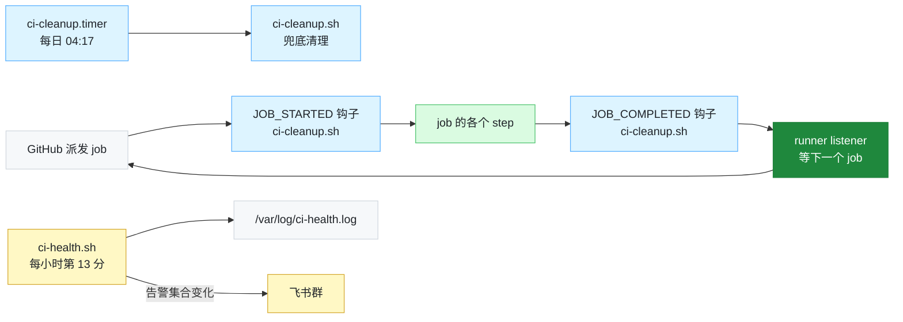

<p align="center">
  
</p>

<p align="center">
  
  
  
  
  
  
  
</p>

# 自建 GitHub Actions CI runner 部署手册

这份手册的用途：换服务器时不必重新调研一遍，跑两个脚本、对一遍验收表就能到位。

它是一套通用做法，覆盖判断机器够不够、装机、改 workflow、接线、验证和运维。

- 所有数字都来自一次真实落地：一台 Hetzner 4c/7.5G 机器加一个 pnpm monorepo。
- 引用实测值的地方都标了「参考项目」。这些数字是例子，不是要求。

---

## 15 分钟快速开始

按下面 6 步走。

```bash
# 1. 判断这台机器够不够用（只读）
CI_HOST_PORTS="5433 6379 9000" bash scripts/preflight.sh --with-load

# 2. 装机、注册、加固（可以重复跑；参数会存到 /etc/ci-runner.env，下次重跑不用再传）
GH_REPO=owner/repo GH_TOKEN=<一次性PAT> \
RUNNER_LABELS=self-hosted,linux,x64,ci \
CI_APP_PORTS="3100 3101" CI_LABEL=com.myorg.ci=1 \
CI_FIXEDWORK_BASELINE=<上一步给的 p50> \
bash scripts/bootstrap.sh
#    可选：CI_HEALTH_GH_TOKEN=<只读 token>        监控「本机 job 是否连续失败」用
#          CI_ALERT_WEBHOOK=<飞书机器人地址>  CI_ALERT_SECRET=<签名密钥>   告警推送到飞书群

# 3. 自检
GH_REPO=owner/repo GH_TOKEN=<token> bash scripts/verify.sh

# 4. 改 workflow：没有脚本，必须有人读一遍第 05 章
#    改完之前不要打开开关，否则第 2 个 PR 就会失败

# 5. 接线
gh variable set CI_RUNNER --repo owner/repo --body '["self-hosted","linux","x64","ci"]'

# 6. 连开两个测试 PR，再手动触发一次定时 workflow
```

| 步骤 | 做什么 | 怎么做 |
|---|---|---|
| 1 – 3 | 机器配置 | `preflight.sh` → `bootstrap.sh` → `verify.sh` |
| 4 | 改 workflow | 人工，对照 [05 章](05-workflow改造.md) |
| 5 | 接线 | 设置仓库变量 `CI_RUNNER` |
| 6 | 验证 | 两个测试 PR，加一次手动触发的定时 workflow |

> [!IMPORTANT]
> **第 4 步是唯一不能跳过的人工步骤。**
>
> - 第 1 到 3 步是机器配置。
> - 第 4 步要把仓库里那些「只在一次性 VM 上成立」的写法找出来改掉。失败真正会发生在这里。

---

## 手册里没有、但你必须自己做的两件事

> [!WARNING]
> 1. 配云防火墙（04 章 4.7）。这一步只能在云厂商控制台里配。Docker 会自己写 DNAT 规则，绕过宿主机的 ufw。能挡住这类流量的只有云防火墙这一层。
> 2. 撤销注册用的 PAT（03 章 3.4）。registration token 是一次性的，但用来换取它的 PAT 不是，用完要撤销。

---

## 装好之后，机器上在跑什么

`bootstrap.sh` 把清理钩子挂在 job 的开始和结束两处，另配一个每日 timer 兜底；`ci-health.sh` 每小时采一次点，配了飞书机器人地址就推送告警。



各部分的理由在 [04 章 4.4](04-加固.md)（清理为什么挂三处）和 [08 章 8.2](08-运维与容量.md)（监控与告警阈值）。

---

## 目录

| 章 | 内容 | 什么时候读 |
|---|---|---|
| [01 决策](01-决策.md) | 自建到底值不值；什么时候不该做 | 立项前 |
| [02 选机与验收](02-选机与验收.md) | 怎么判一台机器够不够；四条连通性阈值；steal 可能测不了 | 买机器前 |
| [03 装机与注册](03-装机与注册.md) | 工具链、runner 用户、注册；为什么不要 `--ephemeral` | 装机时 |
| [04 加固](04-加固.md) | Docker / systemd / 清理 / metadata / SSH / 云防火墙 | 装机时 |
| [05 workflow 改造](05-workflow改造.md) | 十一条会坏掉的托管假设，每条给自查命令与改法 | 必读，且要逐条过 |
| [06 接线与回退](06-接线与回退.md) | 开关的正确形状与失败形态；哨兵怎么配才付得起 | 接线时 |
| [07 验证](07-验证.md) | 机器侧自检 + 必须用真实 PR 验的四件事 + 重启演练 | 接线后 |
| [08 运维与容量](08-运维与容量.md) | 清理 / 监控 / 用仿真而不是公式算排队 / 何时加第二台机器 | 长期 |
| [09 踩坑记录](09-踩坑记录.md) | 环境的坑，以及当初判断有误的地方 | 出问题时；也建议先读一遍 |

### 单文件版

单文件版是 [`自建CI-runner部署手册-单文件版.md`](自建CI-runner部署手册-单文件版.md)，便于整篇粘贴到知识库。

- 它由上面各章自动拼装，用 `bash scripts/make-single.sh` 重新生成。
- 改内容请改分章文件，不要改单文件版，否则两版会漂移。

---

## 脚本

| 脚本 | 用途 | 幂等 |
|---|---|---|
| `scripts/preflight.sh` | 候选机自检，输出 GO/NO-GO。只读 | — |
| `scripts/bootstrap.sh` | 装机 + 注册 + 加固 | 是 |
| `scripts/verify.sh` | 装完或重启后自检，输出 PASS/FAIL 表 | — |
| `scripts/ci-cleanup.sh` | 清理钩子（由 bootstrap 安装到 runner 的 hooks/） | 是 |
| `scripts/ci-health.sh` | 每小时健康采点（由 bootstrap 安装到 /usr/local/bin/） | 是 |
| `scripts/ssh-guard.sh` | SSH 加固的安全网：一条 SSH 会话都不剩时才回滚配置 | 是 |
| `scripts/make-single.sh` | 由分章生成单文件版 | 是 |
| `scripts/analysis/` | 调研期的测量工具（连通性采样、排队仿真、单步资源画像） | — |

补充说明：

- `bootstrap.sh`：加 `--harden-ssh` 才会改 SSH 配置；加 `--skip-runner` 跳过 runner 注册。参数会存到 `/etc/ci-runner.env`，在已部署的机器上重跑时不用再传。有 job 在运行时它会拒绝执行。
- `verify.sh`：基本只读。它会试跑一次清理钩子，有 job 在跑时自动跳过这次试跑。

### 这些脚本测到了什么程度

| 路径 | 验证方式 | 结果 |
|---|---|---|
| `bootstrap.sh` 幂等重跑 | 在一台已配置完成的机器上完整重跑（2026-09） | 通过 |
| `bootstrap.sh` 2026-10 新增的段落 | 逐段单独测试；线上按它的生成结果逐文件部署并逐字节比对 | 通过 |
| `bootstrap.sh` 从零安装 1–3 步 | 干净 `ubuntu:24.04` 容器 | 通过 |
| `bootstrap.sh` 第 4–8 步 | 需要 systemd，容器里测不了 | 仅在已有机器上验证过效果 |
| runner 注册段 | 需要真 token 与真仓库 | 全新注册路径未自动化验证 |
| `preflight.sh` | 本机实跑 | 13 PASS / 2 WARN |
| `verify.sh` | 本机实跑（2026-10-16 重启后） | 34 PASS / 0 FAIL |
| `ci-cleanup.sh` / `ci-health.sh` | 以 runner 用户实跑 | 通过 |

<details>
<summary><b>各项细节</b></summary>

<br>

- `bootstrap.sh` 幂等重跑：退出码 0，12 项关键状态逐字节相同（仅注释文本被标准化）。
- `bootstrap.sh` 从零安装 1–3 步：docker / node / gh / psmisc 全部从零装成，`daemon.json` 生成正确。
- runner 注册段：本次是在已注册的机器上跑的，走的是「已注册，跳过」分支。
- `preflight.sh`：各项与已知实测值吻合。
- `verify.sh`：实跑时抓出了脚本自身的两个 bug。

</details>

> [!CAUTION]
> `bootstrap.sh` 第 4–8 步仅在已有机器上验证过效果，首次在全新机器上跑请盯着输出。runner 全新注册路径未自动化验证。

---

## 这份手册的边界

手册的内容是一次真实落地之后整理出的操作步骤，按执行顺序排列，配有可直接运行的脚本。所有数字都是实测值，没有取自文档。

手册不包含那次落地的论证过程。

- 「为什么 N=1（只注册一个 runner）够用」「为什么不合并 job」这类结论，背后的仿真数据与实测台账留在内部的核验报告里，没有随手册发布。
- 手册里引用结论的地方都直接给了数字和测法，一般不需要回溯原始台账。

> [!NOTE]
> 标「参考项目」的地方都是举例：一个 4 人小队的 pnpm monorepo，跑在 4 核 / 7.5 GiB 单机上的实测值。你的数字会不同，但测法是通用的。
